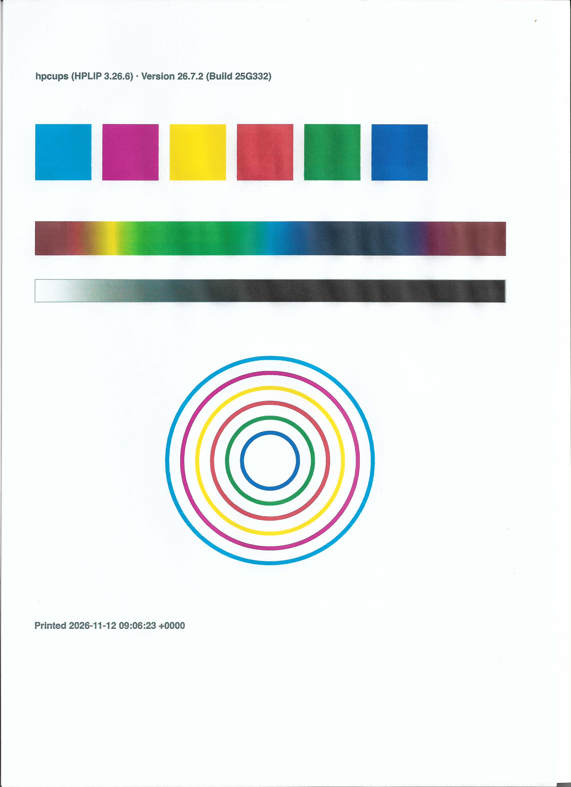
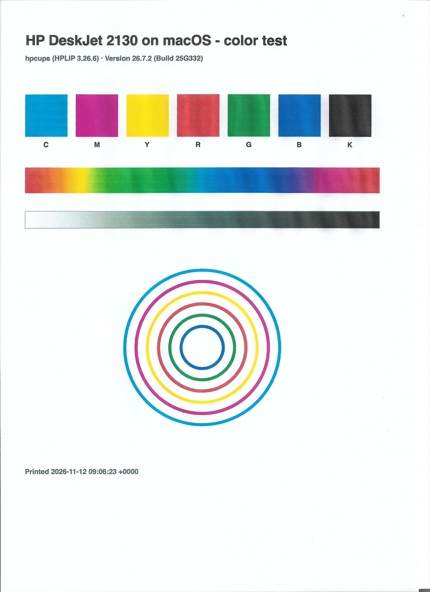

# HP Legacy Printers for macOS

A native macOS port of HP's open-source HPLIP 3.26.6 drivers. It covers USB HP printers
and multifunction devices that HP no longer supports on macOS, for both printing and scanning.

**Tested:** HP DeskJet 2130 (print in color and black-only; scan in color, gray and black & white) on Intel macOS 26.
It also prints from a second Mac (a MacBook Air).
**Should work, untested:** the other 761 models in [SUPPORTED-PRINTERS.txt](SUPPORTED-PRINTERS.txt).
These are mostly DeskJet, OfficeJet, Photosmart, ENVY, Business Inkjet and older LaserJet models.
Every printer language they use has been run through the filter offline, but none of them has printed on paper.

**Not supported:**
- LaserJets that need HP's closed-source plugin (ZjStream/ZxStream models such as the P1102 and M1132)
- the JPEG-based LaserJet formats (hbpl1, ljjetready, quickconnect)
- network-only printers, which this build doesn't reach. Networked HP printers usually support AirPrint and need no driver on macOS.

| Part | What it is | Installed to |
|---|---|---|
| Printing | `hpcups` CUPS filter + 762 PPDs | `/Library/Printers/HPLIP/filter`, `/Library/Printers/PPDs/Contents/Resources/HPLIP/` |
| Scanning | HPLIP's SANE `hpaio` backend (with hpmud, hpip and libusb linked in) | `/Library/Printers/HPLIP/lib/libsane-hpaio.so` |
| `hpscan` | Command-line scanner: PNG, JPEG, TIFF or PDF | `/Library/Printers/HPLIP/bin` (added to `PATH`) |
| HP Scan | Small app wrapping `hpscan` | `/Applications/HP Scan.app` |

Every binary is universal (Intel and Apple Silicon) and needs macOS 11 or later. The HP Scan app needs macOS 13 or later.
The installer sets up every connected HP USB printer it has a driver for, for example `HP_DeskJet_2130`.
Printers plugged in later are set up by macOS automatically. Or add one in System Settings → Printers & Scanners and pick the "… hpcups 3.26.6 (macOS)" driver.
The scanner tools use the first HP scanner they find. To pick a different one, use `hpscan -L` to list them and `hpscan -d <device>` to choose.

## Build

Requirements: Xcode (for `swiftc`) or the Xcode command-line tools, and Python 3. No Homebrew is needed.

```bash
make pkg
```

That builds everything and writes `build/hp-legacy-printers-macos.pkg`. Along the way it:
- downloads HPLIP 3.26.6 and libusb 1.0.30 into `third_party/` and checks each against a pinned SHA-256
- applies `patches/` to HPLIP and builds every binary for both Intel and Apple Silicon
- rewrites the PPDs with `tools/make-ppds.py`, which also decides which models are included

`make clean` removes the build output; `make distclean` also removes the downloaded sources.

## Install / uninstall

```bash
sudo installer -pkg build/hp-legacy-printers-macos.pkg -target /
```

```bash
sudo /Library/Printers/HPLIP/uninstall.sh
```

Installing this package over the older DeskJet-2130-only package (`hp-deskjet-2130-macos.pkg`) is meant to replace it: the old 2130-only PPD is removed and existing printers are re-pointed to the new one. This upgrade path is not tested yet.

## Scanning

```bash
hpscan -r 300 -m Color ~/Documents/scan.pdf
```

`-m` takes `Color`, `Gray` or `Lineart`. `-R` lists the supported resolutions (75, 100, 200, 300, 600, 1200). `-L` lists scanners.

## Installing the unsigned package on another Mac

Without Developer ID certificates, the package is unsigned. Its binaries are still ad-hoc signed, which Apple Silicon requires.
Copy it over (USB stick or AirDrop), then do either of these:

- **Terminal** (no Gatekeeper prompt):

  ```bash
  sudo installer -pkg ~/Downloads/hp-legacy-printers-macos.pkg -target /
  ```

- **Finder:** double-click the `.pkg` and click **Done** on the "can't be verified" warning. Then open System Settings → Privacy & Security, scroll down and click **Open Anyway**. Enter your password and run the installer.

Plug in and switch on the printer first, so the installer can create the print queue.

## Troubleshooting

- **Printer missing, or the driver isn't offered in Add Printer, right after installing:** the installer restarts the printing system, so this should no longer happen. If it does, restart the Mac, then unplug the printer and plug it back in.
- **Chrome only shows "Save as PDF":** the HP is under Destination → **See more…** until you've printed to it once. ⌥⌘P opens the macOS dialog instead.
- **Anything else:** run `sh /Library/Printers/HPLIP/diagnose.sh > ~/Desktop/hp-diagnose.txt 2>&1` and look at (or share) the report.

## Signing and notarizing (for other Macs)

An unsigned package installs fine on the Mac that built it. On any other Mac, Gatekeeper blocks it.
A Developer ID–signed, notarized package installs with a double-click.

**One-time setup** (Apple Developer Program membership required):

1. Create two certificates in Xcode → Settings → Accounts → (your team) → Manage Certificates → **+**:
   - **Developer ID Application** signs the binaries and the app.
   - **Developer ID Installer** signs the `.pkg`.

   Only the team's Account Holder can create Developer ID certificates.
2. Create an app-specific password at <https://account.apple.com> → Sign-In and Security → App-Specific Passwords.
3. Store the notary credentials in your keychain (`TEAMID` is the 10-character ID in the certificate names):

   ```bash
   xcrun notarytool store-credentials hplip-notary --apple-id YOUR_APPLE_ID --team-id TEAMID
   ```

**Each release:**

```bash
make clean notarize
```

The Makefile finds both identities in the keychain automatically. It then:
- signs every binary with the hardened runtime and a secure timestamp
- signs the package
- submits the package to Apple and waits (usually a few minutes)
- staples the ticket so the package also verifies offline
- checks the result with `spctl`

If a certificate isn't picked up automatically, set `DEVELOPER_ID="Developer ID Application: …"` and `INSTALLER_IDENTITY="Developer ID Installer: …"` explicitly.

## Changes from upstream HPLIP

- The proprietary `libImageProcessor` blob is compiled out (`DISABLE_IMAGEPROCESSOR`). Only LaserJet "ljzjstream" models use it.
- The JPEG-based LaserJet encoders (QuickConnect, LJJetReady, Hbpl1) are compiled out, which removes the libjpeg dependency.
- Fixes to HP's PPDs, all in `tools/make-ppds.py`. With them, all 762 pass `cupstestppd`:
  - about 20 newer models default to a "Letter" size they call `US_LETTER`
  - some constraints refer to page sizes the PPD never defines
  - some Smart Tank PPDs list the same size twice
  - a few short names exceed the 31-character limit
- `patches/0002`: `utils.h` and `Utils.h` collide on macOS's case-insensitive filesystem.
- `patches/0003`: `CFPlugInCOM.h` clashes with `hpip.h`'s Windows-style `ULONG`.
- Color mode asks for RGB instead of RGBW for every PCL3GUI2 model (the 2130's printer language). Since HPLIP 3.21 the PCL3GUI2 encoder is color-only and drops the separate black plane, so pure-black text and graphics went missing in color prints.
- `hpscan` snaps to the device's supported resolutions; the backend otherwise falls back to 75 dpi without saying so. It also waits out the ~10 s "busy" period after each scan.

## Before and after the color fix

| HPLIP as shipped (black missing) | With the fix |
|---|---|
|  |  |

Both are scans of the [test page](docs/color-test-page.pdf) printed on a DeskJet 2130. `tools/make-color-testpage.swift` generates the test page.

## License

This repository is licensed under the **GNU General Public License v2.0** (see [LICENSE](LICENSE)). That covers the build files, patches, tools, `hpscan` and the HP Scan app.

The upstream code it builds keeps its own licenses:
- **HPLIP:** GPL-2.0, with some parts under BSD/MIT. See `COPYING` in the HPLIP source.
- **libusb:** LGPL-2.1, linked statically into the scanner backend.

If you distribute built packages, you must also offer the corresponding source. That means this repository plus the exact HPLIP and libusb tarballs, which `make` downloads into `third_party/dl/`.

## Disclaimer

This is an unofficial community project. It is not affiliated with, endorsed by, or supported by HP Inc. HP, DeskJet, OfficeJet, LaserJet, ENVY, Photosmart and Smart Tank are trademarks of HP Inc. or its affiliates. It comes with no warranty; see the license.
